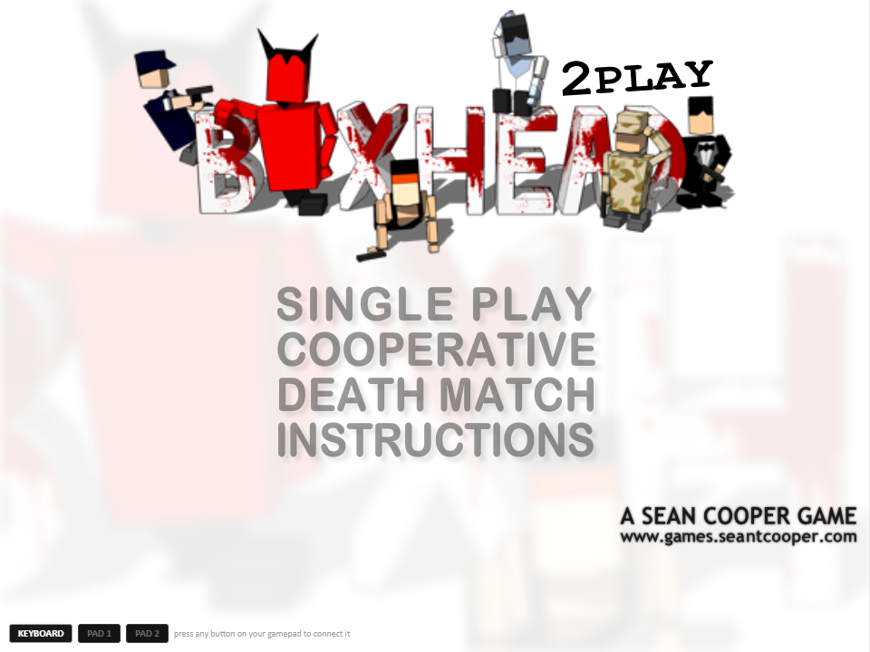
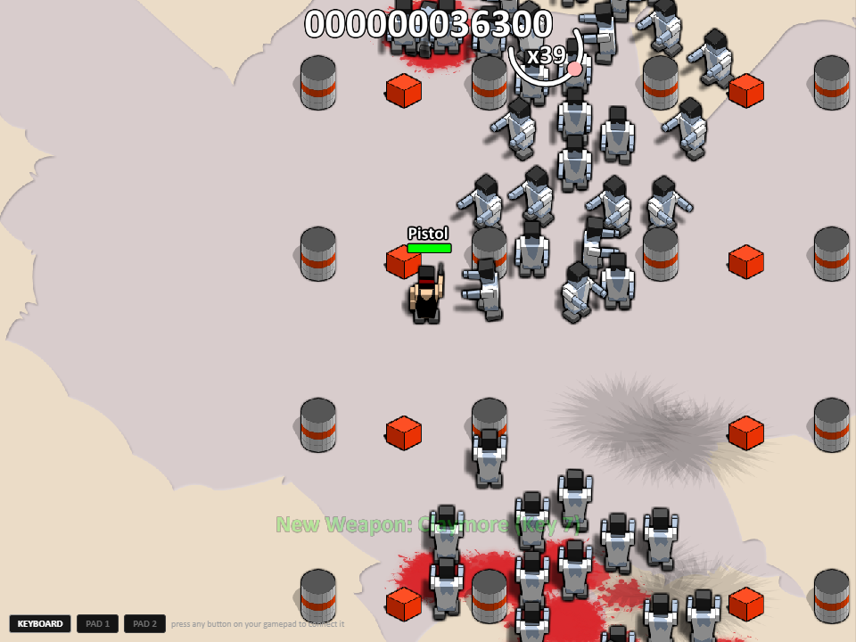
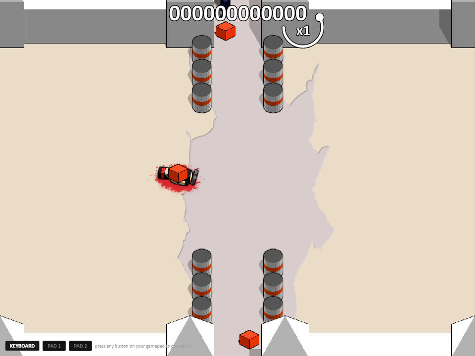

# Boxhead: 2Play Rooms — 1:1 现代复刻



把 2007 年的 Flash 经典 **Boxhead: 2Play Rooms**（作者 Sean Cooper）从原始 SWF 逆向后用
**TypeScript + Canvas2D + Electron** 一比一复刻：数值、状态机、时序、画面布局乃至原版的小怪癖都完全保留，
同时带来 2 倍分辨率光栅化、本地存档、手柄和局域网联机。



- **逐类移植**：原版 114 个 ActionScript 2 类逐文件移植为 TypeScript（`src/game/`），源码里的 `[BC]` 注释可回溯到 SWF 字节码偏移。
- **自写反混淆器**：原 SWF 做过控制流平坦化混淆，ffdec 反编译结果错误百出——本项目自写 AVM1 反汇编器，所有可疑代码按真实字节码还原。
- **原汁原味**：美术、字体、音效在构建时从原版 SWF 直接提取（无需 Java / ffdec）；用仓库内真 Flash Player 跑注入探针实测 for..in 顺序、滤镜像素等细节，作为测试金标准。
- **超越原版**：随时存档（SAVE & QUIT / CONTINUE）、波次检查点重试、协作死亡武器箱、起始波次选择、手柄、局域网联机——全部在 `src/game/deviations.ts` 与 `PARITY.md` 逐条登记。

> 仅供学习研究。原版游戏版权归 Sean Cooper 所有；本仓库不含任何提取出的素材，素材在本机构建时从原版 SWF 生成。

## 快速开始

**Windows 便携版（推荐）**

```bash
npm install
npm run dist        # 生成 release/Boxhead 2Play Rooms-<版本>-portable.exe
```

双击 exe 即可游玩（单文件免安装，存档在 exe 旁的 `Boxhead2PlayRooms-data/`）。
首次打包需联网下载工具链，失败时在命令前加 `NODE_USE_ENV_PROXY=1`；未签名 exe 首跑的 SmartScreen 提示选"仍要运行"。

**浏览器**

```bash
npm install
npm run dev         # 首次自动从 SWF 提取素材，然后打开 http://localhost:5173/
```

## 玩法

| 模式 | 说明 |
|---|---|
| Single Play | 单人闯关，击杀累积倍数（multiplier），倍数过阈值解锁新武器与升级（UZI ×5、霰弹 ×10……共 58 项） |
| Cooperative | 两人同屏合作，共享分数与升级，倒下后在队友附近复活，双双倒下才结束 |
| Death Match | 两人分屏对战，无怪物，开局全武器但只有手枪有弹药，先被击杀指定次数者败 |

18 个房间（BOXY … BIG ONE）；选项里可调难度、速度、恶魔开关、碰撞、友伤与对战局数，全部与原版相同。

### 操作

| 动作 | 玩家 1 | 玩家 2 |
|---|---|---|
| 移动 | 方向键 | W A S D |
| 射击 | `/`（单人也可空格） | 空格 |
| 换武器 | `.` / `,` | E / Q |
| 选武器（仅单人） | 数字键 1–0 | — |

`P` 暂停；键位可在选关界面 Controls 窗口改；`F11` / `Alt+Enter` 全屏；右键菜单可切换声音、画质与渲染清晰度（2x/1x）。

**手柄**（标准映射，可与键盘混用）：左摇杆/十字键移动，RT/LT 或 A 射击，RB/LB 换枪，START 暂停；
菜单里摇杆驱动虚拟光标、A 确认。左下角输入徽标实时显示两台手柄的归属，点一下即可互换。

## 超越原版的功能



- **存档与重试**：暂停界面 **SAVE & QUIT** 随时存档退出，主菜单 **CONTINUE** 从存档波次续玩；死亡后 **RETRY** 从本波开局的检查点重试（分数/武器/倍数还原）。单槽位。
- **协作死亡武器箱**：Coop 里玩家死亡时原地掉落一个红箱，内含其背包全部武器与**实际剩余弹药**；重生后（或队友）走上去即可取回——队友拾取时取两者较优，不会变弱。
- **起始波次选择**：选关界面左下角 `START WAVE` 循环器可选 1–100 波开局（默认 1 = 原版行为），选定后按原版难度锚点配给"打到该波次应有的"武器与升级。
- **局域网联机**（仅便携版）：主菜单 **LAN GAME** → 一台建房、一台自动发现或输 IP 加入 → 双方就绪后进传统双人选人界面（房主统一选择、客机镜像）→ 开局。断线有 30 秒自动重连 + 检查点无缝续局；对局流量每方向仅约 2–4 KB/s，高延迟虚拟局域网也自动加大输入缓冲不卡帧。双方需同一构建版本。

## 与原版的差异

全部登记在 `src/game/deviations.ts`（23 条）并收录于 `PARITY.md`，要点：

- 移除赞助商内容（CMG Logo、More Games、外链、在线排行榜与统计上报）；高分改为本地保存（每房间 × 模式前十），Instructions 改本地页。
- 帧计时用调度的 enterFrame 时间，任意刷新率下保持原版 50fps/25Hz 逻辑；画面默认 2 倍分辨率光栅化（可切回 1x）。

## 开发

```bash
npm run extract     # SWF -> public/assets（library.json、xsi.json、位图、音效）
npm run disasm      # AVM1 反混淆反汇编 -> generated/
npm test            # 单元 + 无头模拟（含 Flash 实测金标准对比）
npm run typecheck
npm run build && npm run dist   # 浏览器构建 + 便携 exe（dist:dir 免安装目录）
```

- `gallery.html`（`npm run dev` 后访问）：浏览 SWF 里的任意元件/帧。
- 仓库布局：代码在根（`src/ engine+game`、`tools/` 提取与反汇编管线、`tests/`）；原版资产在 `assets/`（SWF、反编译 AS2、历代 Flash Player、音频参照）。工程规则见 `CONVENTIONS.md`，逐版本对照审计见 `PARITY.md`。

| 路径 | 内容 |
|---|---|
| `tools/swf/` | 自写 SWF 解析器：形状、变形形状、时间轴、字体/文本、按钮、位图、音效 |
| `tools/avm1/` | AVM1 反混淆反汇编/反编译器、registerClass 提取 |
| `tools/oracle/` | 对照测量：AVM1 汇编器、SWF 写出器、真 Flash Player 探针运行器 |
| `src/engine/` | Flash API 子集（geom、BitmapData、滤镜、Graphics、AS2 语义）+ 显示列表播放器 + 平台层（输入、音频、50Hz 循环、右键菜单、存档） |
| `src/game/` | 原版 AS2 类的逐文件移植（`packages.ts` 保留原版点号包名）；`local/` 为复刻新增功能 |
| `electron/` | Electron 主进程（`app://` 协议、4:3 窗口、全屏、便携存档、LAN 传输） |
