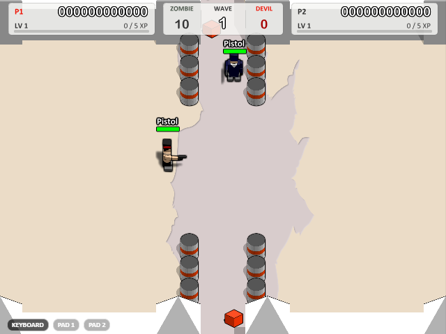

# Boxhead: 2Play Rooms — a 1:1 modern remake


[简体中文说明点这里](README_zh_cn.md)

## Introduction

A byte-faithful remake of the 2007 Flash classic **Boxhead: 2Play Rooms** (by Sean Cooper), reverse-engineered
from the original SWF and rebuilt in **TypeScript + Canvas2D + Electron**. Every value, state machine, timing,
layout — even the original's quirks — is preserved and pinned by tests, while the remake adds 2×-resolution
rasterization, save & resume, gamepad support and LAN multiplayer.


- **Class-by-class port** — all 114 ActionScript 2 classes ported file-by-file (`src/game/`); `[BC]` comments
  trace every suspicious line back to a SWF bytecode offset.
- **A hand-written deobfuscator** — the original SWF ships control-flow-flattened, so ffdec output is unreliable;
  this project has its own AVM1 disassembler and resolves disputed code against the real bytecode.
- **Original look & sound** — art, fonts and audio are extracted from the original SWF by the project's own
  extractor (no Java, no ffdec) and **committed to the repo**, so a standard build never touches the SWF. A real
  Flash Player in `assets/` runs injected probes (for..in order, filter pixels, …) as test goldens.


## Quick Start

**Windows portable (recommended)**

```bash
npm install
npm run dist        # -> release/Boxhead 2Play Rooms-<version>-portable.exe
```

Double-click the single-file exe (saves live in `%USERPROFILE%\.boxhead`). The first packaging
downloads toolchain bits — prefix `NODE_USE_ENV_PROXY=1` if your network needs it — and SmartScreen's
"unknown publisher" prompt just chooses *Run anyway*.

**Browser**

```bash
npm install
npm run dev         # http://localhost:5173/
```

## Controls

| Action | Player 1 | Player 2 |
|---|---|---|
| Move | Arrow keys | W A S D |
| Shoot | `/` (Space in Single) | Space |
| Switch weapon | `.` / `,` | E / Q |
| Direct select (Single) | 1–0 | — |

`P` pauses, `F11` fullscreen, right-click for sound / quality / render scale. Gamepads work everywhere
(stick to move, RT/A to shoot, START to pause); keys are rebindable on the level-select screen.

## Beyond the original


- **Save & resume** — pause-menu **SAVE & QUIT**, main-menu **CONTINUE**; death **RETRY** restarts at the failed
  wave (wave-start checkpoint, or the run's starting wave when none exists yet — score/weapons reset as in the
  original retry).
- **Coop death weapon crate** — a fallen player drops their whole arsenal with live ammo; pickup restores the
  owner exactly and gives the teammate the best of both.
- **Devil supplies** — in single-player and co-op, devils can drop blue armor crates (20%) or olive ammunition
  crates (20%). Armor fills to 100 and absorbs damage before health; its blue fill overlays the original life
  bar, exposing actual health as armor shrinks. Armor pickups never heal, and normal health regeneration
  continues. Ammunition refills every owned weapon to that player's upgraded capacity, including empty weapons.
  LAN peers negotiate support before enabling these drops.
- **Start-wave selector with progression** — the level-select `START WAVE` cycler lets you jump straight back to
  the best wave you have fought up to (shown as `BEST` beside it), with the loadout the original's difficulty
  curve would have granted by then. A fresh save can only start at wave 1 — the historical best persists in the
  save and caps the cycler; in LAN the host's best is the cap.
- **Personal LAN co-op progression** — separate last-hit scores, permanent levels and original weapon upgrades
  for each player. Zombies award 1 XP and devils 5 XP; every 5 XP grants a level, up to 125. Top corner
  score/level/XP panels flank the current wave and its remaining zombie/devil totals (including pending spawns),
  with individual upgrade summaries while paused. Retry restores the current wave's starting growth and
  inventory; a fresh selected-wave run grants its baseline level. Local co-op and death match retain their
  original rules.
- **LAN multiplayer** (portable build) — host & auto-discover or join by IP for co-op and death match.
  Rollback applies local input on the next simulation tick without waiting for the peer, with immediate local
  weapon audio and display interpolation at the monitor's refresh rate. Redundant UDP inputs use TCP as a
  reliable fallback. Short disconnects recover from input history; a restarted peer resumes from a checkpoint
  within the 30 s reconnect window. Either player can RETRY from the debrief. Confirmed gameplay remains
  deterministic; prediction may visibly correct under poor links. See the [measurements and tradeoffs](docs/verification/v0.2.7/README.md).
- **One data folder** — every build (the portable exe included) keeps all user game data — saves and settings —
  in `%USERPROFILE%\.boxhead`, migrated there automatically on first run: one folder to manage and back up.



Intentional deviations are registered in [`src/game/deviations.ts`](src/game/deviations.ts) and audited in
[`PARITY.md`](PARITY.md): sponsor content (CMG logo, online scores, external links) is replaced by local
highscores; timing stays at the original 50 fps logic on any refresh rate.

## Development

```bash
npm test             # unit + headless-simulation suites (incl. Flash-player golden diffs)
npm run typecheck
npm run build        # renderer build (asset extraction is skipped when up to date)
npm run extract      # regenerate public/assets from assets/boxhead_2play_rooms.swf
```

Layout: `src/engine/` — Flash API subset + display-list player + platform layer; `src/game/` — the ported
classes; `tools/` — the SWF extractor and AVM1 toolchain; `tests/` — unit, sim and real-playtest suites;
`assets/` — the original SWF and the reference Flash players. Engineering rules: `CONVENTIONS.md`.
`gallery.html` (via `npm run dev`) browses every symbol of the original SWF.

## Game Asset

***The original Boxhead: 2Play Rooms is © Sean Cooper (2007), sponsored by Crazy Monkey Games. The assets in
this repository are extracted from the original SWF for learning and research only — do not use them
commercially. Fan project, not affiliated.***

## Contacts

- Original author: [seantcooper.com](https://www.seantcooper.com/)
- Issues & PRs: [github.com/Xi-Gong/boxhead_remake](https://github.com/Xi-Gong/boxhead_remake)
