# Boxhead: 2Play Rooms — a 1:1 modern remake


[简体中文说明点这里](README_zh_cn.md)

## Introduction

The 2007 Flash classic **Boxhead: 2Play Rooms** by Sean Cooper, rebuilt in **TypeScript + Canvas2D + Electron**.
A class-by-class AS2 port preserves the original art, sound and game logic, with 2× rasterization, saves,
gamepads and LAN multiplayer. Intentional additions are documented in [PARITY.md](PARITY.md).

<p align="center"><a href="assets/readme/menu.png">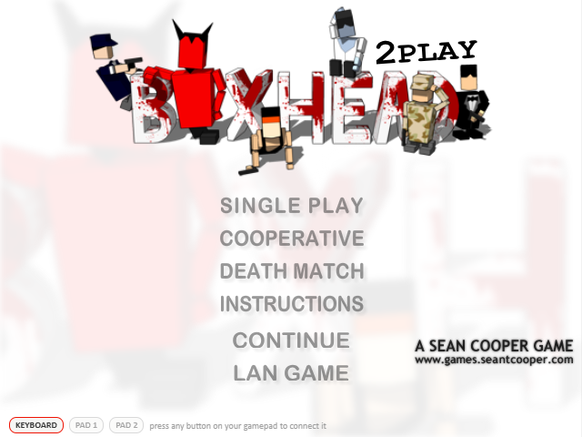</a></p>

## Quick Start

**Windows portable:** download the single-file exe from [Releases](https://github.com/Xi-Gong/boxhead_remake/releases/latest).
**v0.3.8** lowers Boss health by **40%**, ordinary devil health by **30%** and ordinary zombie health by **20%** across all four difficulties. Zombie-family damage, movement and attack speed fall by **15% / 12% / 15%**. The shotgun gains **15%** base damage and stronger range-edge damage; base shield capacity rises from **40 to 60**.
Every wave ends with an unskippable **three-second** result screen, followed by a fresh press to enter upgrades. No card is preselected: choose one, then confirm READY separately. Attribute sheets show **percentages and caps**, while retaining level/XP and weapon identity. Early clears and Boss victories still grant double upgrades; surviving the deadline grants one.
It retains v0.3.7's LAN/save safeguards and fixes; see the [prioritized audit](docs/verification/v0.3.7/audit_zh_cn.md) and [previous release verification](docs/verification/v0.3.7/README.md).
Saves and settings live in `%USERPROFILE%\.boxhead`.

**Run from source:**

```bash
npm install
npm run dev         # browser: http://localhost:5173/
npm run dist        # Windows portable: release/Boxhead 2Play Rooms-<version>-portable.exe
```

Packaging downloads its toolchain on the first run; use `NODE_USE_ENV_PROXY=1` if your network requires it.

<p align="center"><a href="assets/readme/gameplay.png">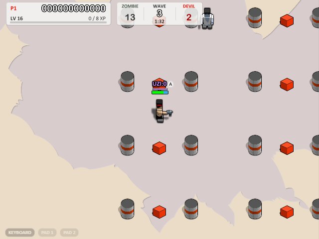</a></p>

Nightmare with **START WAVE 1** now enters **WAVE 1 / LV 1**, with the pistol. [Difficulty selection](assets/readme/nightmare-options.png).

<p align="center"><a href="assets/readme/nightmare-wave-one.png">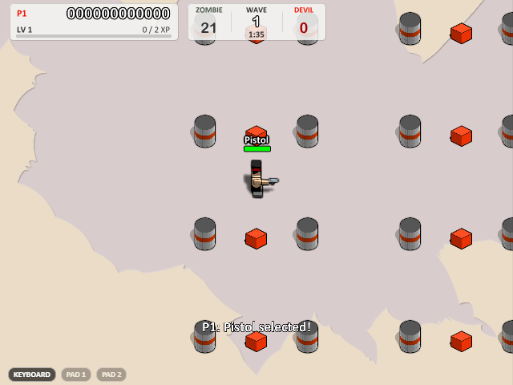</a></p>

## Controls

| Action | Player 1 | Player 2 |
|---|---|---|
| Move | Arrow keys | W A S D |
| Shoot | `/` (Space in Single) | Space |
| Switch weapon | `.` / `,` | E / Q |
| Direct select (Single) | 1–0 | — |
| Inspect stats between waves | Tab (rebindable) | R (rebindable) |

`P` pauses, `F11` toggles fullscreen. Right-click for sound, quality and render scale.
Gamepads: stick/d-pad to move, B/LT/RT to fire, LB/RB to cycle and START to pause. Hold fire on the keyboard or controller for continuous firearm shots at the normal weapon rate. Grenades retain charge/release and deployables retain press-to-place/detonate. In modern PvE, tap A/Y to switch bound weapons; hold either for 0.8 seconds to bind/unbind the held weapon. A confirms menus and upgrades; X toggles stats on the upgrade screen. At wave end, wait the full three seconds, release old input, then tap the displayed fire key / controller A or click ENTER UPGRADES. Co-op waits for both players. On the upgrade screen, select a card first, then make a separate confirmation. Local co-op shows both players' stats together; LAN players inspect only their own.

Use the letters printed on your controller. The bottom-left pad selector offers **AUTO / XBOX / NINTENDO** and remembers each device/slot. Recognizable SN30/Switch names choose Nintendo automatically; when an SN30 reports a generic Xbox/XInput name, choose **NINTENDO** once. The final shot switches to the pistol; unlocked empty weapons remain selectable and give a short alert when fired. Last remote charges can still be selected and detonated.

<p align="center"><a href="assets/readme/controller-layout.png">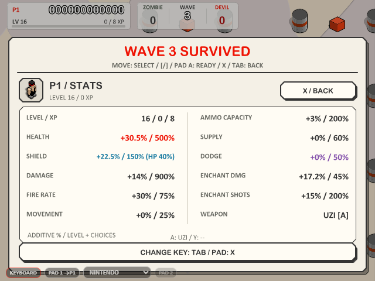</a></p>

## Beyond the original

- **Save, resume & retry** — continue a saved run, retry the failed wave, or select a previously reached wave. The selected Wave is exact on all four difficulties; Wave 1 starts at level 1 with the pistol. Higher difficulty changes enemy numbers, spawn cadence, health, damage, movement, attack speed and growth. Both LAN peers need this updated build for the new rule; older peers retain their negotiated behavior.
- **LAN co-op & death match** — discover rooms or join by IP in the desktop app, with rollback and reconnect support.
- **Timed, endless PvE** — clear finite enemy groups early or survive ordinary 80–105-second rounds. Every fifth wave adds 30 seconds and 2–4 Bosses, each with one compact overhead health bar and counted under DEVIL. Boss rounds allow two ordinary reinforcements at once.
- **Ammunition and shotgun** — finite base stocks are UZI 125, shotgun/rocket/grenade 25, railgun 19, barrel/mine/remote charge 13 and wall 7. Shotgun base damage is 15% higher than v0.3.7, and range-edge pellets retain 55% of near damage instead of 45%; its 14-tick base period, spread and pellet count remain.
- **Clear results, cards and attributes** — an unskippable three-second result screen precedes a fresh entry confirmation. No card starts selected; navigate or click a card, then confirm READY separately, with no upgrade timeout. The comic-paper window shows exact percentage previews and caps, including dodge up to 50%; attributes omit raw health, shield, damage, rate, ammo and durability counts. Level/XP, weapon identity and shortcuts remain. Early clears and Boss victories double the reward.
- **Tiered, endless PvE growth** — low early XP costs lead to slower elite levels. Levels continue beyond 125; health, armor, damage and capacity share explicit percentage caps. Wave selection follows your best progress and grants a map-duration-based starting build. Old saves retain earned progression and their XP curve, then immediately adopt the new combat rules on load.
- **Native enemies and Bosses** — ordinary zombies and original fireball devils, with chargers and their extra 50% crate roll retired. Relative to v0.3.7, Boss/ordinary devil/ordinary zombie health falls by 40%/30%/20%; zombie-family damage, movement and attack speed fall by 15%/12%/15%. Boss health uses its own reduction once. Disabling devils selects non-charging zombie Bosses; counts, timing and difficulty differences remain.
- **Enchantment power and endurance** — enchanted attacks start at +15% damage; levels and power cards add percentage points up to +45%. Durability is independent of ammo: purple crates refill it, ammo supplies do not. Levels and endurance cards raise its capacity. The raised purple strip stays narrower than health and at most half its height.
- **Shield and four supplies** — start with 160 health and an empty 60-capacity shield, capped at 40% of final health. Blue armor overlays the original green health bar; partial armor exposes the health beneath. Every useful armor crate fills it completely. Medical, armor, enchantment and ammunition crates each have a 25% drop chance.
- **Comfort and setup** — type an unlocked starting wave directly, change LAN room rules as host, and enjoy softer explosion flashes and automatic audio recovery.
- **Four survival difficulties** — sparse opening waves with two-hit pistol zombies ease into stronger, larger later hordes and more, less durable Bosses. A finite objective rewards active clearing; survival to the limit also advances. Older peers retain their supported rules.
- **Clearer combat art** — five refined gun models, warm bullet tracers, cyan rail beams, directional rockets and matching enchanted effects. Compact native Boss bars match player health-bar height; player health bars keep their existing design.
- **Reliable supplies and clearer UI** — refills preserve inherited weapon capacity; confirmed P1/P2 pickup messages remain evenly spaced, and conditional lobby actions have room to breathe.
- **Weapon shortcuts and recovery** — unlocked empty weapons remain selectable and bindable. A/Y labels and hold progress show shortcuts; death crates preserve ammunition and enchantment durability without adding duplicate durability.

[Feature details](docs/features.md) · [v0.3.8 verification](docs/verification/v0.3.8/README.md) · [v0.3.7 verification](docs/verification/v0.3.7/README.md) · [v0.3.6 verification](docs/verification/v0.3.6/README.md)

<p align="center"><a href="assets/readme/wave-clear.png">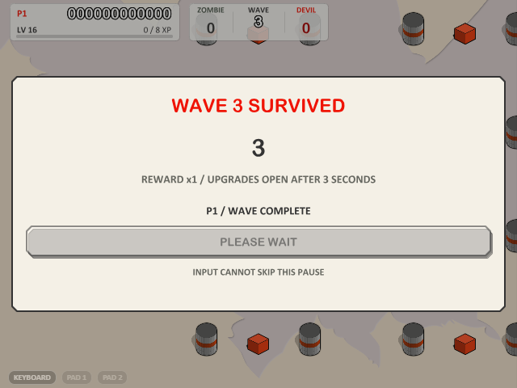</a></p>

<p align="center"><a href="assets/readme/upgrade-cards.png">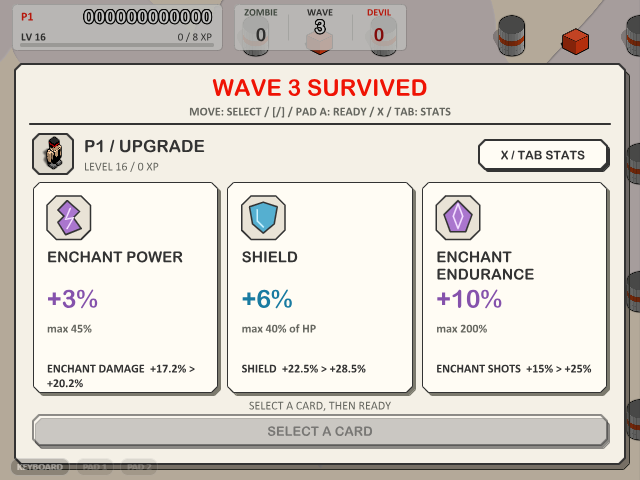</a></p>

<p align="center"><a href="assets/readme/coop-stats.png">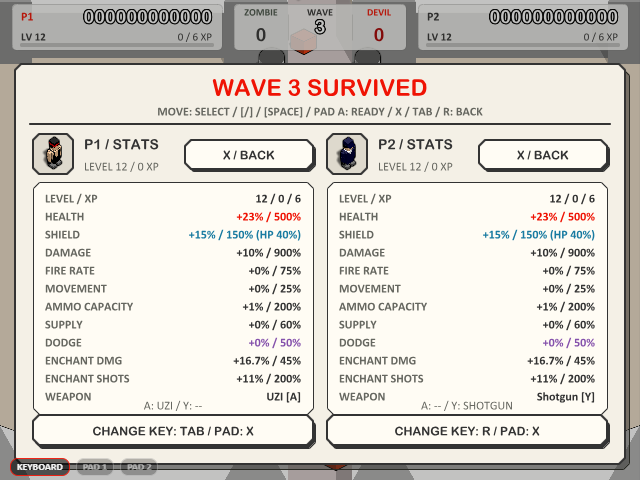</a></p>

<p align="center"><a href="assets/readme/boss.png">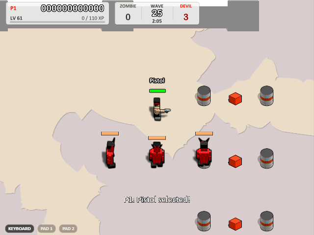</a></p>

<p align="center"><a href="assets/readme/coop-crate.png">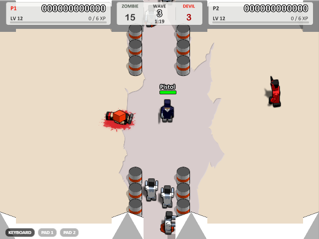</a></p>

<p align="center"><a href="assets/readme/lan-growth.png">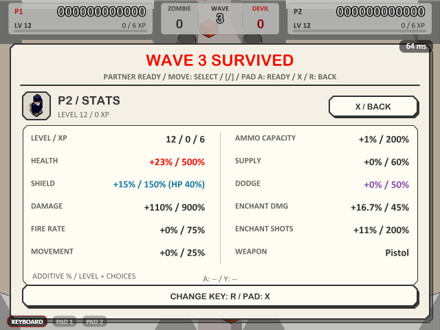</a></p>

<p align="center"><a href="assets/readme/devil-supplies.png">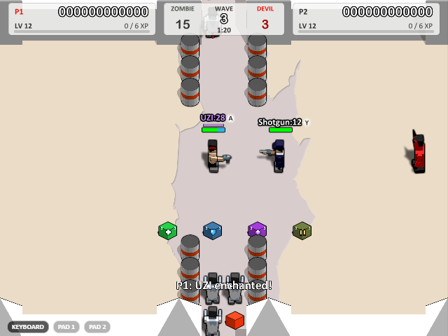</a></p>

## Development

```bash
npm test
npm run typecheck
npm run build
npm run extract      # regenerate committed assets from the original SWF
```

`src/engine/` implements Flash APIs; `src/game/` contains the port; `tools/` holds the extractor and AVM1 tools.
Standard builds use committed assets. Open `gallery.html` through the dev server to browse original symbols.
See [engineering conventions](docs/CONVENTIONS.md) and the [documentation index](docs/README.md).

## Game Asset

***Boxhead: 2Play Rooms © Sean Cooper (2007), sponsored by Crazy Monkey Games. Extracted assets are for
learning and research only; no commercial use. This fan project is not affiliated with the original author.***

[Original author](https://www.seantcooper.com/) · [Issues & PRs](https://github.com/Xi-Gong/boxhead_remake)
