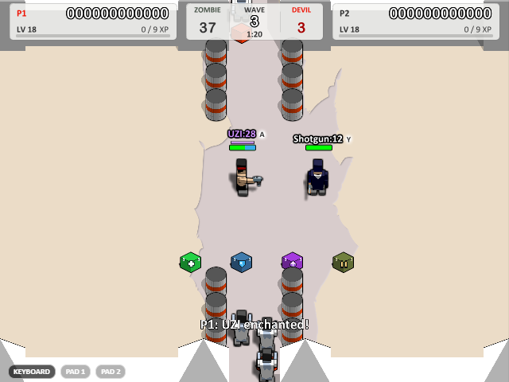

# Boxhead: 2Play Rooms — a 1:1 modern remake


[简体中文说明点这里](README_zh_cn.md)

## Introduction

The 2007 Flash classic **Boxhead: 2Play Rooms** by Sean Cooper, rebuilt in **TypeScript + Canvas2D + Electron**.
A class-by-class AS2 port preserves the original art, sound and game logic, with 2× rasterization, saves,
gamepads and LAN multiplayer. Intentional additions are documented in [PARITY.md](PARITY.md).

<p align="center"></p>

## Quick Start

**Windows portable:** download the single-file exe from [Releases](https://github.com/Xi-Gong/boxhead_remake/releases/latest).
Saves and settings live in `%USERPROFILE%\.boxhead`.

**Run from source:**

```bash
npm install
npm run dev         # browser: http://localhost:5173/
npm run dist        # Windows portable: release/Boxhead 2Play Rooms-<version>-portable.exe
```

Packaging downloads its toolchain on the first run; use `NODE_USE_ENV_PROXY=1` if your network requires it.

<p align="center"></p>

## Controls

| Action | Player 1 | Player 2 |
|---|---|---|
| Move | Arrow keys | W A S D |
| Shoot | `/` (Space in Single) | Space |
| Switch weapon | `.` / `,` | E / Q |
| Direct select (Single) | 1–0 | — |

`P` pauses, `F11` toggles fullscreen. Right-click for sound, quality and render scale.
Gamepads work throughout (stick to move, RT/A to shoot, START to pause); keys are rebindable on level select.

## Beyond the original

- **Save, resume & retry** — continue a saved run, retry the failed wave, or select a previously reached wave.
- **LAN co-op & death match** — discover rooms or join by IP in the desktop app, with rollback and reconnect support.
- **Permanent PvE growth** — solo, local co-op and LAN share personal scores, levels and weapon upgrades, with health and armor capacity rising together. Score popups fly to their owner's panel.
- **More supplies** — devils drop equally likely blue armor, olive ammo or green medical crates, which remain until needed. Random red boxes replenish the floor during play.
- **Comfort and setup** — type an unlocked starting wave directly, change LAN room rules as host, and enjoy softer explosion flashes and automatic audio recovery.
- **Four survival difficulties** — tuned spawn pacing and enemy speed ceilings support progression while preserving original enemy health, damage and per-wave totals.
- **Co-op weapon crates** — fallen players drop their arsenal and remaining ammunition for recovery.

[Feature details](docs/features.md) · [Verification and performance evidence](docs/verification/v0.2.9/README.md)

<p align="center"></p>

<p align="center"></p>

<p align="center"></p>

## Development

```bash
npm test
npm run typecheck
npm run build
npm run extract      # regenerate committed assets from the original SWF
```

`src/engine/` implements Flash APIs; `src/game/` contains the port; `tools/` holds the extractor and AVM1 tools.
Standard builds use committed assets. Open `gallery.html` through the dev server to browse original symbols.
See [engineering conventions](docs/CONVENTIONS.md) and the [documentation index](docs/README.md).

## Game Asset

***Boxhead: 2Play Rooms © Sean Cooper (2007), sponsored by Crazy Monkey Games. Extracted assets are for
learning and research only; no commercial use. This fan project is not affiliated with the original author.***

[Original author](https://www.seantcooper.com/) · [Issues & PRs](https://github.com/Xi-Gong/boxhead_remake)
