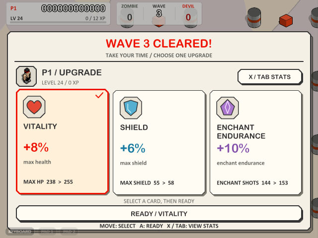
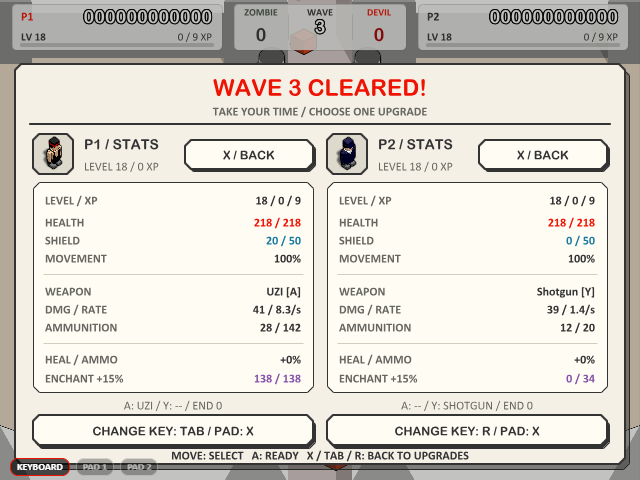
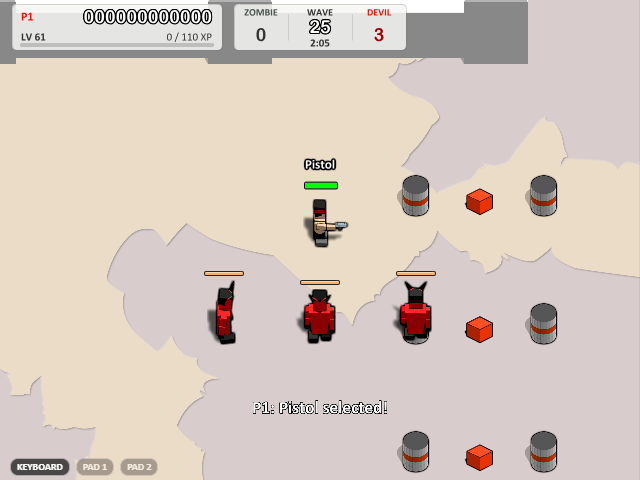

# Boxhead: 2Play Rooms — a 1:1 modern remake


[简体中文说明点这里](README_zh_cn.md)

## Introduction

The 2007 Flash classic **Boxhead: 2Play Rooms** by Sean Cooper, rebuilt in **TypeScript + Canvas2D + Electron**.
A class-by-class AS2 port preserves the original art, sound and game logic, with 2× rasterization, saves,
gamepads and LAN multiplayer. Intentional additions are documented in [PARITY.md](PARITY.md).

<p align="center"><a href="assets/readme/menu.png"></a></p>

## Quick Start

**Windows portable:** download the single-file exe from [Releases](https://github.com/Xi-Gong/boxhead_remake/releases/latest).
**[v0.3.4](https://github.com/Xi-Gong/boxhead_remake/releases/tag/v0.3.4)** adds A/Y weapon bindings, selectable empty weapons and enchantment durability with endurance growth. Armor crates refill the lighter shield completely; redesigned cards and stats accompany a native-only enemy roster and stronger devil Bosses. See the [release verification](docs/verification/v0.3.4/README.md).
Saves and settings live in `%USERPROFILE%\.boxhead`.

**Run from source:**

```bash
npm install
npm run dev         # browser: http://localhost:5173/
npm run dist        # Windows portable: release/Boxhead 2Play Rooms-<version>-portable.exe
```

Packaging downloads its toolchain on the first run; use `NODE_USE_ENV_PROXY=1` if your network requires it.

<p align="center"><a href="assets/readme/gameplay.png"></a></p>

## Controls

| Action | Player 1 | Player 2 |
|---|---|---|
| Move | Arrow keys | W A S D |
| Shoot | `/` (Space in Single) | Space |
| Switch weapon | `.` / `,` | E / Q |
| Direct select (Single) | 1–0 | — |
| Inspect stats between waves | Tab (rebindable) | R (rebindable) |

`P` pauses, `F11` toggles fullscreen. Right-click for sound, quality and render scale.
Gamepads: stick/d-pad to move, B/LT/RT to fire, LB/RB to cycle and START to pause. In modern PvE, tap A/Y to switch bound weapons; hold either for 0.8 seconds to bind/unbind the held weapon. A confirms menus/upgrades; X toggles stats only between waves. Local co-op shows both players together; LAN players independently inspect only their own stats.

## Beyond the original

- **Save, resume & retry** — continue a saved run, retry the failed wave, or select a previously reached wave.
- **LAN co-op & death match** — discover rooms or join by IP in the desktop app, with rollback and reconnect support.
- **Timed, endless PvE** — clear finite enemy groups early or survive ordinary 80–105-second rounds. Every fifth wave adds 30 seconds and 1–3 Bosses, each with one compact overhead health bar and counted under DEVIL. Boss rounds allow two ordinary reinforcements at once.
- **Cards and attributes** — a comic-paper window with large icons, benefits and exact previews. Both players confirm READY without a countdown; defeating all Bosses doubles the reward. X and the actual keyboard shortcut are displayed.
- **Tiered, endless PvE growth** — low early XP costs lead to slower elite levels. Continue beyond level 125 with growing health, armor, weapon damage and ammo capacity. Wave selection follows your best progress and grants a map-duration-based starting build. Old saves retain earned progression and their XP curve, then immediately adopt the new combat rules on load.
- **Native enemies and Bosses** — ordinary zombies and original fireball devils, with chargers and their extra 50% crate roll retired. Devil Bosses move, attack and hit moderately harder; disabling devils selects non-charging zombie Bosses.
- **Enchantment endurance** — +15% damage and one extra bullet target, with per-emission durability independent of ammo. Empty weapons retain it, purple crates refill it, and ammo supplies do not. A slim purple meter shows remaining shots; levels and endurance cards raise its capacity.
- **Lighter armor and four supplies** — start with 160 health and an empty 40-capacity shield shown as a separate cyan strip. Every useful armor crate fills it completely. Medical, armor, enchantment and ammunition crates each have a 25% drop chance.
- **Comfort and setup** — type an unlocked starting wave directly, change LAN room rules as host, and enjoy softer explosion flashes and automatic audio recovery.
- **Four survival difficulties** — tuned pacing, concurrency and speed ceilings, with increasingly strong enemies. A finite objective rewards active clearing; survival to the limit also advances. Older peers retain their supported rules.
- **Clearer combat art** — five refined gun models, warm bullet tracers, cyan rail beams, directional rockets and matching enchanted effects. Compact Boss bars suit the retained original bodies; player health bars keep their existing design.
- **Reliable supplies and clearer UI** — refills preserve inherited weapon capacity; confirmed P1/P2 pickup messages remain evenly spaced, and conditional lobby actions have room to breathe.
- **Weapon shortcuts and recovery** — unlocked empty weapons remain selectable and bindable. A/Y labels and hold progress show shortcuts; death crates preserve ammunition and enchantment durability without adding duplicate durability.

[Feature details](docs/features.md) · [v0.3.4 release verification](docs/verification/v0.3.4/README.md) · [v0.3.2 verification](docs/verification/v0.3.2/README.md)

<p align="center"><a href="assets/readme/upgrade-cards.png"></a></p>

<p align="center"><a href="assets/readme/coop-stats.png"></a></p>

<p align="center"><a href="assets/readme/boss.png"></a></p>

<p align="center"><a href="assets/readme/coop-crate.png"></a></p>

<p align="center"><a href="assets/readme/lan-growth.png"></a></p>

<p align="center"><a href="assets/readme/devil-supplies.png"></a></p>

## Development

```bash
npm test
npm run typecheck
npm run build
npm run extract      # regenerate committed assets from the original SWF
```

`src/engine/` implements Flash APIs; `src/game/` contains the port; `tools/` holds the extractor and AVM1 tools.
Standard builds use committed assets. Open `gallery.html` through the dev server to browse original symbols.
See [engineering conventions](docs/CONVENTIONS.md) and the [documentation index](docs/README.md).

## Game Asset

***Boxhead: 2Play Rooms © Sean Cooper (2007), sponsored by Crazy Monkey Games. Extracted assets are for
learning and research only; no commercial use. This fan project is not affiliated with the original author.***

[Original author](https://www.seantcooper.com/) · [Issues & PRs](https://github.com/Xi-Gong/boxhead_remake)
