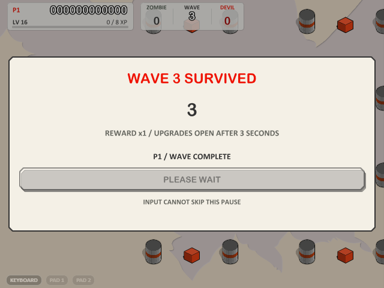
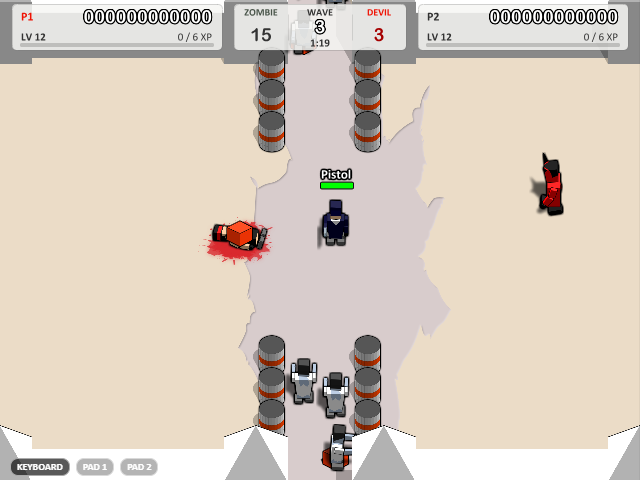
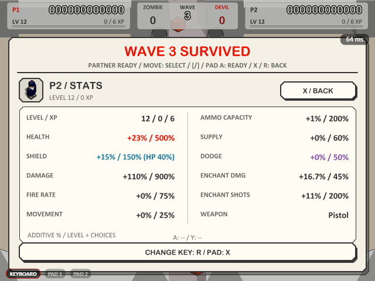
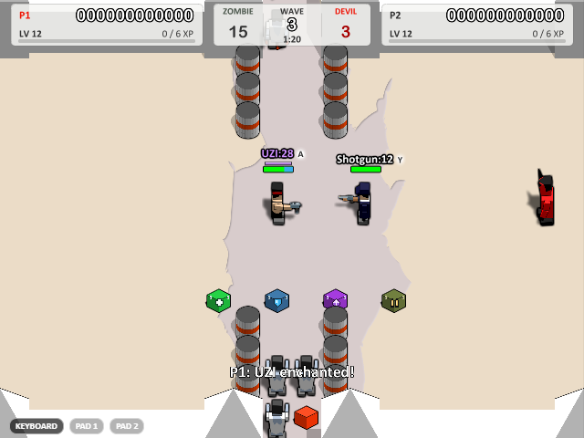

[Back to README](../README.md)

## Beyond the original

### Timed waves, Bosses and run upgrades

Solo, local co-op and compatible LAN co-op loop indefinitely. Death match retains its rules.

Modern v0.3.8 rounds retain targets of **90 seconds normally and 120 seconds for Bosses**, adjusted to authored floor area and entrance paths: ordinary maps last 80–105 seconds; Bosses add 30 seconds. Menus show the exact limit. Pause, draft and disconnect freezes stop the simulation clock. Clear the finite ordinary objective or survive; defeating every Boss ends its round immediately. Timeouts grant no passive XP or kill rewards.

Finite objectives use the actual map deadline with a zombie budget coefficient rising from 14% at wave 1 to 46% at wave 25. Concurrent groups grow from two opening zombies to at most 25 at HIGH and 16 at LOW. Enemies enter only through reachable original spawn points, never random ground near a player. Arrival windows alternate with recovery gaps. Distant or wall-obscured approaches accelerate and slow for contact. The underlying thirty-wave horde health layers remain: ordinary zombies 0.38×–1.10×, ordinary devils 0.85×–1.25× and Bosses 0.45×–0.80×, before difficulty and progression modifiers. **v0.3.8 further reduces Boss health by 40%, ordinary devil health by 30% and ordinary zombie health by 20%, relative to v0.3.7.** Boss health receives only its own reduction. All zombie-family enemies, including zombie Bosses, deal 15% less damage, move 12% slower and advance their attacks 15% slower. Attack reduction is independent of movement and follows the existing speed cap. First-wave zombies still take two base pistol hits on every difficulty; enemy objectives, spawn cadence and difficulty differences remain. All enemies have no armor.

The modern roster contains original zombies and fireball devils. Chargers, their skills and the extra 50% red-box roll are retired. Every fifth wave uses 2–4 native devil Bosses; disabling devils selects non-charging zombie Bosses. Two ordinary zombie reinforcements remain independent of Boss slots. Devil Boss movement, attack-animation progression and damage increase by 15%, 15% and 10% relative to the previous native Boss; projectile speed and range stay unchanged. Initial attacks are staggered by member slot. Retired behavior remains isolated for older negotiated rules and historical fixtures.

Every wave ends with a separate result screen for **three full seconds**. Keyboard, controller and mouse input cannot skip it or queue an early confirmation. Afterward, release old input and freshly tap the displayed fire key / printed controller A, or click **ENTER UPGRADES**. Co-op waits for both players. Pause and disconnect freezes stop the countdown.

Then choose an offense, defense or utility card with exact current-to-next previews. **No card starts selected, and READY stays disabled until you choose.** Move or cycle weapons to select a card, then make a separate A/fire press or READY click; mouse card clicks select only. First forward navigation selects the first card, backward selects the last. The entry press never also selects or confirms a card. **The upgrade screen has no timeout or automatic choice.** **X**, P1 **Tab** or P2 **R** opens stats only during this stage; actual rebound keys are shown. Single shows the player, local co-op opens both P1/P2 together, and LAN shows only the local player with independent toggles. Opening blocks the corresponding draft input; closing waits for held keys to release. LAN values come from confirmed ticks. The entire comic-paper window uses original portraits, large icons, clear benefits and red/green state markers.

All permanent bonuses add **percentage points** from levels and choices, rather than multiplying the current total. Cards show the exact change, current/next percentage and cap. The ten attribute rows display only current percentages and caps: no raw health, shield, damage, shots per second, ammo or durability counts. Level/XP, weapon name and A/Y bindings remain, and shield notes the 40%-of-final-health constraint. The pause summary also uses percentages. Integer health/ammo and weapon tick ceilings still apply.

| Attribute | One reward | Cap |
|---|---|---|
| Damage / Health / Shield | +8 / +8 / +6 points | +900 / +500 / +150%; shield also ≤40% final HP |
| Capacity | +8 points | +200% of the new base |
| Fire rate / Movement | +6 / +4 points | +75 / +25%, plus per-weapon tick floors |
| Supply effect | +10 points | +60% |
| Enchant endurance | +10 points | +200% |
| Enchant damage | +3 points | 45% total extra damage |
| Dodge | +3 points | 50% chance |
| First aid / Resupply | Restore 35% max health / finite ammo | Actual maximum; supply improves recovery |

Rewards persist within the run, including saves and retries; new runs reset them. Capped choices are excluded. **Clearing every finite target before the deadline or defeating all Bosses doubles the chosen benefit**; merely surviving earns one and grants no unearned kill XP. New selected-wave builds distribute ten permanent attributes and derive earned XP without assuming early-clear perks or Boss kills. Saved allocations stay intact. Armor-piercing rewards remain retired.

All finite authored base ammunition is raised by 25%, rounded up: UZI 125, shotgun/rocket/grenade 25, railgun 19, barrel/mine/remote charge 13, wall 7. Capacity bonuses reach at most three times these new bases. Only the authored pistol stays infinite. Inherited finite surplus is never truncated by refills or upgrades. Shotgun base cooldown remains 14 ticks. With `shotgun-boost-v1`, base pellet damage is 15% higher than v0.3.7, and distance falloff retains 55% at maximum range instead of 45%. Range, spread, pellet count, ammunition cost and enchantment consumption remain; enchantment scales the emitted attack once. Direct rocket self-blast damage remains 15% before armor. Supplies restore 40% of maximum, improved by bounded efficiency; armor crates fill the cap. Natural regeneration and weapon unlocks remain.

Dodge uses the seeded simulation RNG before damage and hit reactions. A successful dodge prevents the whole eligible hit, including armor consumption and stagger. Zero chance, spawn protection and legacy peers consume no additional dodge random draw. Saves and rollback retain the allocation, and LAN sheets display only confirmed percentages.

The v2 save container retains optional rule markers, timers, offers, bonuses, identities and skills. The new `enemy-relief-v1`, `shotgun-boost-v1`, `shield-boost-v1` and `wave-clear-gate-v1` capabilities negotiate separately with their dependencies; older peers keep supported rules. Existing Boss encounters adopt the reduced health once while retaining remaining HP fraction, member progress and clocks. Raising shield capacity leaves current armor unchanged; loading does not refill ammo or reactivate exhausted enchantment. The result countdown, individual entry confirmations and explicit card choices survive saves and rollback. Old saves already open on upgrades keep their offers and confirmed players, while unconfirmed players explicitly select again. Old saves migrate immediately when v3 is available: retain earned progression and inventory, scale health/armor by their remaining fractions, convert retired enemies by family and turn piercing points/cards into firepower. Existing clocks and completion fractions remain; rereading a converted save does not convert it again. LAN negotiates combat-pve-v3 with all dependencies; older peers retain their supported rules and cannot load v3 saves. Classic art and assertions remain available.

- **Save & resume** — pause-menu **SAVE & QUIT**, main-menu **CONTINUE**; death **RETRY** restores the failed
  wave's starting checkpoint, or the run's starting state when no wave checkpoint exists yet, including its
  progression, score and inventory.
- **Coop death weapon crate** — a fallen player drops their whole arsenal with live ammo; pickup restores the
  owner exactly and gives the teammate the best of both.
- **Devil supplies** — every native devil, including its Boss, drops one equally likely armor, ammunition, medical or enchantment
  crate. These crates stay across waves and saves until a living player can benefit. Armor fills only armor,
  medical restores only health, and ammunition replenishes all owned weapons without unlocking new ones. Full players
  leave the crate for later or for their teammate. Modern LAN peers negotiate these rules; older peers retain
  their supported rules.
- **Red boxes** — only the original weighted pool of already unlocked weapons, replenishing the selected weapon.
  A full or empty reward still consumes the box, with no reroll.
  Fixed boxes return after 24 seconds. Every 20 simulation seconds, 1 solo or 2 co-op boxes appear on reachable,
  empty floor, up to 3/6 active random boxes. These last 45 seconds; pausing stops the timer.
- **Start-wave input** — type an ASCII decimal number or use the arrows; the range is 1 through the historical
  `BEST` wave, extending beyond 100 with modern PvE. Leading zeros are normalized. Invalid text opens an in-game prompt and cancels
  starting or switching; Enter/blur commits, Escape restores the last valid value. Each visit starts at wave 1,
  and typing never unlocks waves. The LAN host edits against their own save cap; the guest sees a readonly value.
- **Personal PvE progression** — solo, local co-op and LAN share last-hit scores, permanent levels and weapon upgrades
  for each player. Ordinary zombies award 2 XP, devils 10, and Bosses 50. New runs use basic level costs of 2–5 XP through level 10,
  6–15 XP through level 30, then 20 XP plus 3 per further level. Existing runs retain their saved curve.
  The original weapon unlock table remains at levels 1–125, with no modern PvE level cap. Top corner
  score/level/XP panels flank WAVE and its clock. Ordinary-wave counts include the unspawned objective;
  Bosses count under DEVIL. There are individual upgrade summaries while paused.
  Retry restores the current wave's starting growth and
  inventory; a fresh selected-wave run grants its baseline level from the same earned-wave curve,
  with no difficulty head start. Kill scores use the level before that kill's upgrade. Local co-op keeps its shared
  camera and controls; death match retains its rules. Old v2 local saves convert once while preserving total
  score, health/armor fractions, weapons and ammo; co-op splits old score equally, with any odd point going to P1.
- **Growing survivability** — start at 160 health and empty 60-capacity armor. Base health adds 2 per level through 10, 3 through 30 and 4 afterward. Level vitality growth and +8-point health choices add against the 160-health base, capped at +500%. Armor adds level vitality growth and +6-point choices against a base of 60 with `shield-boost-v1` (40 for older supported rules), capped at +150% and 40% of final health, displayed as blue armor over the original health bar. Level/armor picks do not refill armor; armor crates do. Full/dead players leave crates for an eligible teammate. Armor absorbs damage 1:1 before health, with normal overflow and lethal hits. Shield reaction resistance, natural regeneration and health-on-level-up remain.
- **Endless weapon growth** — new runs add 1% weapon damage and 0.5% finite capacity per level at 11–30,
  then 2% and 1% per level from 31 onward. Existing saved curves retain their post-125 growth of 1% damage and
  `max(1, ceil(capacity at level 125 × 0.005))` finite ammo per level. Only the added capacity is supplied;
  modern refill capacity is bounded while previously earned finite surplus remains usable. Saves restore current supplies without a bonus refill.
- **Four PvE difficulty curves** — Single and co-op retain Beginner, Intermediate, Expert and Nightmare pacing,
  active caps and speed ceilings. Modern waves replenish within a finite reduced objective; legacy finite-wave budgets stop at 200 zombies and 10 devils, including variants.
  The selected starting Wave is exact on all four difficulties; Wave 1 starts at level 1 with the pistol.
  Difficulty changes enemy counts, initial health/damage/movement/attack and wave growth instead of granting player levels or weapons.
  Enemy health/damage continue scaling from the earned-wave reference level, with bounded additional movement and attack growth.
  LAN enables `difficulty-waves-v1` after both peers negotiate it; older peers retain compatible rules and existing saves keep their actual saved Wave.
  See the [balance audit and explosion measurements](verification/v0.2.8/README.md).
- **Enchanted weapons** — purple crates fill the held weapon’s independent enchantment durability without adding ammunition. Each successful shot or placement spends one unit; a shotgun volley counts once and failed placement costs nothing. Empty ammo keeps remaining durability and can receive a purple crate. Ammo refills and reconstruction preserve remaining durability; they do not replenish it. The final emitted attack and its children retain the damage bonus captured at emission (initially +15%) and the normal enchantment effects. Exhaustion returns the gun to ordinary damage. The purple combat meter shows remaining durability; the attribute sheet shows only endurance percentage and its cap. Death crates merge by maximum, never addition; empty enchanted payloads do not grant ammunition. Legacy persistent enchantment converts once to a full budget; finite old stock converts by remaining units. Fake walls cannot enchant.
- **A/Y weapon shortcuts** — every unlocked weapon remains selectable with zero ammunition. In modern PvE, tap A/Y to select, or hold for 0.8 seconds to bind the held gun, replace a binding or unbind the same gun. A gun occupies one key; labels and hold progress show the result. Bindings are personal to the run and survive death, waves, retry, saves and reconnects. Menus/drafts retain A confirmation; B/LT/RT fire. Pausing, losing focus, disconnecting, changing guns or entering a draft cancels a hold.
  Firearms repeat at their unchanged rate while keyboard or controller fire is held, without requiring AutoFire unlocks. Grenades retain charge/release; deployables retain press-to-place/detonate. Connected controllers' inputs are merged so an idle second pad cannot cancel Single-player fire. Older peers retain their original weapon trigger rules through `held-fire-v1` negotiation.
  Xbox and Nintendo layouts follow printed letters, including menu A and draft X. Auto detection covers recognizable SN30/Switch names; the bottom-left per-pad selector remembers explicit overrides for generic XInput IDs. A layout change cancels holds until release. The final successful finite shot/placement returns to the pistol; selecting an empty weapon retains it and attempted fire plays the original alert, repeating at most every 10 simulation ticks. Empty remote charges remain useful while a placed charge can be detonated. Older peers retain their negotiated behavior through `empty-weapon-feedback-v1`.
- **Reliable pickups and spacing** — supply effects synchronize personal maxima and preserve higher inherited
  capacities within the modern cap. Red single-weapon rewards replenish only the selected weapon. P1/P2 notices use three evenly spaced
  confirmed HUD rows with smooth entry and fade; conditional lobby controls have separate action rows.
- **LAN multiplayer** (portable build) — host & auto-discover or join by IP for co-op and death match.
  Rollback applies local input on the next simulation tick without waiting for the peer, with immediate local
  weapon audio and display interpolation at the monitor's refresh rate. Redundant UDP inputs use TCP as a
  reliable fallback. Short disconnects recover from input history; a restarted peer resumes from a checkpoint
  within the 30 s reconnect window. Either player can RETRY from the debrief. Confirmed gameplay remains
  deterministic; prediction may visibly correct under poor links. See the [measurements and tradeoffs](verification/v0.2.7/README.md).
- **Room settings** — the host can edit difficulty, speed, devils, player collisions, friendly fire and applicable
  victory conditions in the waiting room and setup; the guest sees changes immediately. Rules are fixed once
  play starts and retained on resume. With co-op friendly fire disabled, player shots pass through teammates;
  movement collision remains a separate option.
- **Presentation and audio** — confirmed kill scores animate once toward the owner's actual score panel, with
  pause and resize support. Explosion screen flashes are softened while blast art and gameplay remain intact.
  Audio retries startup and recovers stalled or failed output automatically, retaining the mute setting.
- **One data folder** — every build (the portable exe included) keeps all user game data — saves and settings —
  in `%USERPROFILE%\.boxhead`, migrated there automatically on first run: one folder to manage and back up.

Intentional deviations are registered in [`src/game/deviations.ts`](../src/game/deviations.ts) and audited in
[`PARITY.md`](../PARITY.md): sponsor content (CMG logo, online scores, external links) is replaced by local
highscores; timing stays at the original 50 fps logic on any refresh rate.

### Enchantment durability

Base budgets: pistol **60**, UZI **120**, shotgun/railgun **30**, rocket/grenade **24**, barrel/mine/charge pack **12**.
With `percent-stats-v1`, durability is `floor(base × (1 + min(2, 0.01 × (level − 1) + 0.10 × endurance picks)))`, capped at three times base. Older peers retain `floor(base × (1 + 2x/(2+x)))` for the same x. Boss rewards grant two picks. Increasing the cap adds only its difference to a still-active enchantment; exhausted enchantment stays exhausted. Existing builds are not redistributed.

### Enchantment power and compact meters

With `percent-stats-v1`, the enchantment damage multiplier is `1 + min(0.45, 0.15 + 0.0015 × (level − 1) + 0.03 × power picks)`. Older `enchant-power-v1` peers retain `1 + 0.15 × (1 + 2x/(2+x))` for `x = 0.01 × (level − 1) + 0.10 × power picks`. It scales the owner's attack once at emission, including the last durability unit; existing projectiles and placed explosives keep that captured damage. Normal attacks remain unchanged. Boss cards grant two points; exact previews and the attribute sheet show the percentage bonus and cap. Older peers retain +15%.

The enchantment strip is about 30×3.5 logical pixels, no wider than health and at most half its height. Native Boss health uses about 36×7.5, matching player health height. Bright and dark edges remain inside each strip. Four difficulties retain exact selected waves. Early health and finite enemy objectives use the horde profile. v0.3.8 applies its health and zombie damage/movement/attack reductions over the established progression, while preserving objective counts and round timing.

The v2 save format adds optional capabilities, bindings and durability fields. Old armor migrates once by remaining fraction; retired charger Bosses become the current native family with HP fraction, member slot and clock preserved. Unsupported new saves are rejected before changing a legacy world.
