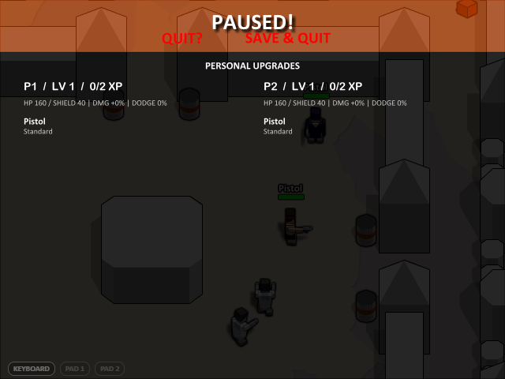
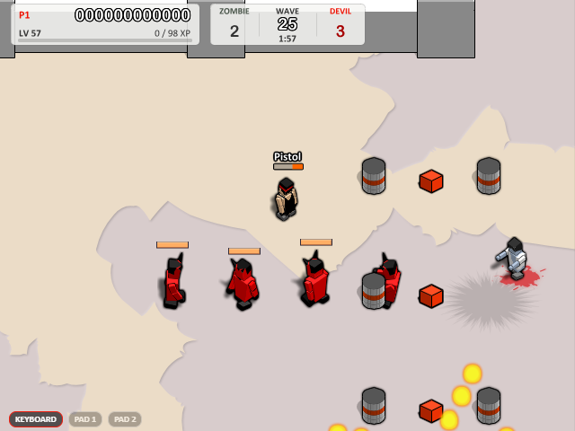
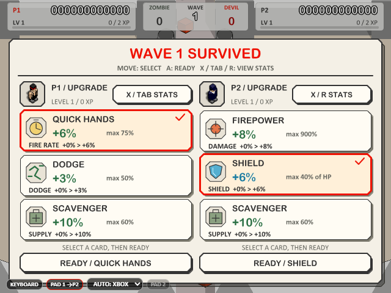

# v0.3.7 游戏审查记录

本轮按“可复现缺陷、已有兼容行为、测试夹具问题、待验证建议”区分结果。优先级为：P0 阻断发布/灾难性丢档；P1 可使对局异常、越权或持续消耗资源；P2 特定存档/恢复失败、误操作或误导性界面；P3 非阻断改进。本轮未确认P0，确认五项 P1、四项 P2，均已修复。未通过的尝试和受环境限制的运行保留，不计入通过数。

| 优先级 | 问题与触发方式 | 玩家影响 | 修复 |
|---|---|---|---|
| P1 | 第16图开场同tick生成相邻敌人，待初始化演员未计入入口占用 | 两只僵尸互等且不可受击，耗尽并发槽，整波零击杀 | safe-entrances-v1 独立协商，从待初始化演员推导入口/首步占用；原输入6000tick由0分恢复至6100/7600；e69a51c |
| P1 | LAN 仅检查 JSON 语法；畸形输入、配置、welcome 和非法发现端口可进入处理器 | 回调异常、非法对局状态或连接错误 | 传输和会话入口运行时校验、双向身份核验，非法消息受控断开；0ff1cac |
| P1 | 首局尚未创建会话的房主收到客机 start；已连接端重放 hello/welcome | 客机可绕过房主设置开局，房间成员/能力被重新写入 | bridge 按房主身份约束方向，传输拒绝握手重放；54e57a1 |
| P1 | 加载/暂停时持续发送遥远未来 tick 的输入与摘要 | 三类 Map 无上界增长；原类实测各保留 5000 条 | 入口限制既有历史保留窗和 head+2048 上界；修复后该样本各为 0；67b32ac |
| P1 | 截断 v2 或损坏成长、武器、Boss/警告等嵌套字段仍通过浅检查 | 错误显示 CONTINUE；恢复可能抛错或先写入部分世界 | 本地、applyToWorld 和网络检查点共用纯预检，写入前拒绝；保留 v2 和历史可选字段；8086bb5；正常敌人首帧缺省兼容跟进 b699157 |
| P2 | 永久补给累积后检查点超过 TCP 64KiB；600 箱样本为 78573 字节 | 长局断线后的完整检查点不能传输 | 双向协商 large-frames-v1，保留小帧/旧端行为，重组上限 8MiB；6981daa |
| P2 | 坏存档玩家坐标为 -1000 或 1e300，虽有限却在地图外 | 恢复到不可操作位置 | 按实际 18 图边界预检；正常旧档与 PATCHY 原版几何保留；980926e |
| P2 | 四成员Boss遭遇仍只清理前三条血条 | 第四名死亡、离镜或遭遇缩小后残留旧血条 | 清理专用层全部拥有的子血条再按当前/确认元数据绘制；旧生产页复现四条均可见，修复后第四区域橙色136→0像素；85fcef2 |
| P2 | 现代手柄A在战斗中按住，跨入升级时从快捷键变成确认键 | 无新按键也会锁定升级／准备；原浏览器脚本得[false,true] | 渲染输入桥按world/wave等待原有A物理松开；保留新按下与旧能力。16组复现4败12过，修复后相关37项和原实键浏览器均通过；6338fa0 |

## 机制审查范围

逐图检查单人、合作、对战入口、地图选择、移动/射击/切枪、暂停、保存和继续；补查四难度与 5/15/25/50/125 波和高波次。模拟矩阵覆盖 18 图 × 4 难度 × 3 模式。发布验收另覆盖精确选波、开局血量/目标、Boss 成员到场、奖励/属性、绑定/空枪/持续射击、附魔耐久、掉落、死亡箱、旧档迁移、输入焦点、三种窗口比例、音频、原生窗口和便携入口。

联机从实际打包主进程和独立 renderer 验证握手/大厅、输入、暂停、重试、恢复、共同确认 tick 的完整状态与有序音效/贴花。准备场景仅用于隔离特定条件，报告明确区别正常属性真实按键、无限生命传输夹具和人为爆炸/补给压力场景。

联机新入口修正和大检查点传输分别需要双方支持safe-entrances-v1、large-frames-v1。双方升级v0.3.7后可启用；旧端混合房间保留其原入口/小帧规则，不能把降级协商计作新修复的覆盖。

最终生产页第16图合作入场：正常生命、出生保护自然结束后真实P暂停，两只僵尸均已进入并可受击。

最终生产页四Boss控制场景：第四名致死后HUD剩余3名，前三条仍显示，第四条隐藏；原第四条区域橙色填充136→0像素。该图验证生命周期，不代表自然击杀胜率。

最终生产页升级输入回归：准备期限进入升级，A跨阶段按住并松开后双方仍未准备；P2可继续用方向选择。之后真实新按键才锁定P2，等14秒仍等待P1；并非自然清场难度样本。

## 不应误修的行为

- 原移植 CInput 的旧监听器保留、出生保护闪烁、PATCHY 固定几何，以及旧能力的弹药/敌人/伤害规则有明确兼容约定。静态引用或截图一帧未显示角色不足以证明缺陷。
- 已有原版遗留记录：PATCHY（第11图）合作／对战的一个 P2 出生标记会落在 `(16.5,9.5)` 的固定 Slab 内，原 `Spawn_ValidPosition_Close` 不检查 Solid，因此角色可能被困。该项来自既有原版对照和 [KNOWN_SPAWN_SOLID](../../../tests/sim/soakSuite.ts)，不是本轮新复现；本轮216矩阵的种子没有触发它。[项目约定](../../../AGENTS.md)要求区分原版怪癖并保留此几何兼容，因此本版不把它当作新重制缺陷改写。后续若要提供现代出生修正，应通过独立规则和原版夹具处理。
- 准备场景的无限生命和定位不作为自然难度/胜率证据。自动避障控制器读取坐标再发送真实按键，也不等于人工试玩胜率。
- 沙箱 localhost EACCES、旧 7z 的受限执行、缺少外部原始源码的既有条件项，以及修复后的旧测试占位存档不算已发布游戏缺陷。
- 本轮不以删代码、体积或行数推断性能收益。性能比较保留同机、同 seed、输入计划、分辨率、预热和三轮原始数据，同时报告分配/GC、内存和联机 cadence。

## 后续建议

**P3：联机不兼容原因提示需要细化。** [bridge.ts](../../../src/game/local/Net/bridge.ts) 在 `peerSupportsRun()` 拒绝恢复时优先显示“需要 v0.3.1 timed waves”，而实际缺少的可能是更晚的独立能力，例如 safe-entrances-v1。拒绝不兼容检查点的逻辑正确，旧文案难以说明双方具体差异。建议后续直接列出缺失能力或提示双方更新；本项来自代码分支审查，尚未作为真实界面复现缺陷验收，不阻断本维护版。

**P3：继续后立即暂停时，旧总分可能透过页眉。** 上一候选原生门禁保存、重启、CONTINUE 后立即发送P的[截图](pause-first-frame.png)中，原版大号总分仍可见于半透明暂停页眉之后；玩家与暂停属性可读，暂停、读档及剩余时钟断言均通过。[GrowthHud.ts](../../../src/game/local/Net/GrowthHud.ts)在首次Draw隐藏原总分，Pause负责属性面板，提示应补查首次绘制与立即暂停的时序。当前只有该实际截图与代码路径观察，尚未补独立延迟对照；按轻微显示一致性建议列P3，后续验证后在HUD初始化/暂停中统一处理。

**P3：极端压力下的分配与瞬时长帧。** 同机同配置三轮、v0.3.6／当前包交替，在每100tick重复256爆炸根并保留200箱的窗口中，分配估计中位数房主106.20→112.45MiB/s、客机101.76→114.46MiB/s；最大帧间隔的三轮中位数约89.4→103.2ms、86.6→96.6ms。GC后存活JS堆仍接近（38.66→38.59MiB、38.72→39.43MiB），晚期联机等待计数均为0，当前六个角色输入探针最大55ms，未触及压力场景100ms门槛。该人工极端场景仍有分配和长帧优化空间；建议后续先做分配栈定位和更长窗口复测，不能据此宣称通用提速或已证明泄漏。原始三轮、分配/GC前后堆、资源及帧间隔见[evidence.json](evidence.json)。

没有证据支撑的数值重平衡不随维护版调整。建议后续收集真人在四难度的首场 Boss 到达率、死亡原因和补给利用率，再决定是否需要调整；实体手柄、双机器物理网络和连续多小时自然长局应作为单独的后续覆盖。当前 8MiB 是有意的传输资源上限，超过该大小会明确断开，不能宣称无限检查点容量。

## 验收中发现并修正的候选回归

第一候选的预检把敌人动画 frame 当成必填。完整运行中的两个既有保存断言发现，普通／原生 Devil 在 State_EnterMap 尚未设置动画帧时，合法 capture 会省略 frame；原恢复代码一直使用 frame??0。对原始内存对象和 JSON 往返样本都复现了错误拒绝，确认是新校验的兼容回归，不是夹具问题。b699157 允许该字段缺省，仍拒绝非有限数和错误类型；36 项定向回归和三套类型检查通过。第一候选和部分全套运行已标记中断／不通过并留档，第二候选重新构建，门禁不复用旧包。

第二候选完整运行2036通过、3失败、8既有条件项：一项“客机”单元测试没有建立guest身份，eaa919f只修夹具，89项检查通过。另两项16图零击杀则确实暴露游戏入场死锁；原Bot、简单绕障和只发按键的BFS控制都无法解除。追踪显示相邻僵尸互指首步通道，停在State_Wait/State_EnterMap。e69a51c修复生成入口对待初始化演员的占用判断，保留原机器人与全部击杀断言，63项长测、11项Boss、5项新增回归共79通过，协商/权限91项及独立进程回滚恢复场景通过。真实浏览器在旧候选两种模式均复现失败，第三候选重新构建验收。新增诊断曾因失败格式化器展开循环引用地图而停止，改为布尔断言后复现3败1过；不把这个测试诊断膨胀称作游戏OOM。

第三产物的首次完整运行2046通过、1失败、8既有条件项，第4图原1500tick输入未提前清场。对照确认两个敌人已入场、可受击并正常攻击，机器人贴墙瞄准循环导致3/10后不再击杀；延长原输入至2100tick仍如此，已有按键绕障选项则在同样1500tick完成10/10、余1292tick并获双倍。c7ca13f仅调整该现代夹具的已有控制器选项，并新增旧入口能力夹具，保留原输入、预算和全部提前清场断言，20项定向检查通过。ee21ac4只将入场照片等到出生保护自然结束，保证存活玩家可见，两种真实菜单检查通过。包内运行代码未变，复验前重新核对全部运行输入、70文件、EXE/asar哈希，保留相同第三产物。

第三产物已在一次干净全套中2048通过、0失败、8既有条件项，并通过216矩阵与25项功能门禁。候选期复查另发现通用大包分片会允许100KB普通in消息放大命令/摘要缓存，两个纯回归和真实TCP回归先失败。b4c82b6将超64KiB分片限定为携带snap对象的start，并在接收端拒绝伪造控制分片；52项相关检查和三套类型检查通过。它是尚未发布的新分片实现缺口，不重复计为已发布基线的第九项缺陷。第三候选后续60ms门禁按拥有的进程树停止，明确记为中断；源码和主进程均重新构建，旧包结果仅保留历史。

旧boss-health像素脚本的规则上下文也已纠正：它属于战斗前charger/priest、64×7和三成员夹具，不能直接套到现代四原生Boss。3278d9a用显式旧夹具保留全部原断言，1倍/2倍通过；错误上下文的原尝试保留。由这次复查另确认的第四血条残留则是真实P2，模拟与生产浏览器均先复现，85fcef2修复后37项相关检查通过，源码页136→0像素且完整模拟摘要不变。

最终验收已完成：当前包干净全套2068通过、0失败、8既有条件项；216矩阵、7附加、引擎265/265、真实入场/血条/升级输入与600箱重连通过。按用户加速要求，最终包13项功能门禁通过，另19项明确沿用未改功能的历史覆盖；不是32项最终包重跑。三轮最重负载配对共6次全通过，一组正常属性合作Expert输入样本46.2秒提前清场。哈希、性能中位数、原始数据与覆盖边界见[完整验收记录](README.md)和[evidence.json](evidence.json)。

第四产物虽已完成2052/0/8干净全套、216矩阵和32/32功能门禁，附加draft-input仍发现真实A跨阶段误准备，不能按脚本过期处理。确认现代A战斗时不进入FIRE槽，原升级入口松开检测因此看不到它；进入升级才产生FIRE新边沿。6338fa0只修渲染输入桥，本地状态随world/wave保留并在输入释放生命周期清理；模拟、RNG、线协议和快照不变。16组中4个现代持续按住场景先失败，其余12通过；修复后37项相关检查、三套类型检查和不改断言的原浏览器通过，包括14秒不默认、真实新按键确认。旧完整候选与engine-browser中断留档final-attempt-5，性能尚未运行，修复后全部重建验收并前置附加门禁。
